# StudyBuddy — Technical Documentation

StudyBuddy is an AI learning partner developed as a Master's project at the Westphalian University of Applied Sciences (Institute for Internet Security). It lets students upload their own lecture materials and verifies their understanding through an iterative Socratic dialogue: the agent asks comprehension questions grounded strictly in the uploaded material, evaluates the student's explanations, and keeps asking targeted follow-up questions until every key concept of a topic has been explained.

**Team:** Ahmad Morad, Ibrahim Zarouri, Ibrahim Shaban  
**Supervisor:** Prof. Dr.-Ing. Tobias Urban

---

## 1. System Architecture

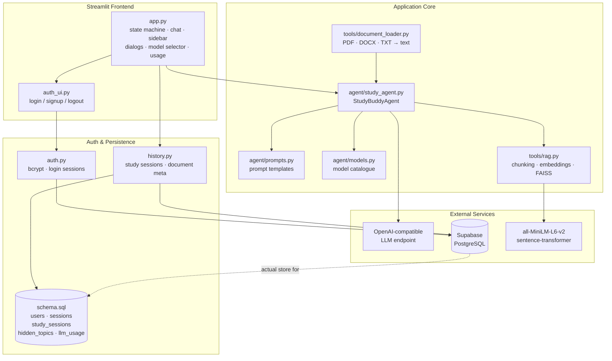

### Project structure

```
Study-buddy/
├── app.py                       # Streamlit UI and application state machine
├── auth.py                      # Accounts, password hashing, login sessions
├── auth_ui.py                   # Login / signup / logout screens
├── history.py                   # Study-session persistence (Supabase / Postgres)
├── schema.sql                   # Database schema
├── agent/
│   ├── models.py                # Model catalogue + context limits
│   ├── prompts.py               # All LLM prompt templates
│   └── study_agent.py           # StudyBuddyAgent: core logic and LLM calls
├── tools/
│   ├── document_loader.py       # PDF / DOCX / TXT parsing
│   └── rag.py                   # Chunking, embeddings, FAISS index
├── tests/
│   ├── test_evaluation_state_machine.py   # State-machine tests (mocked LLM)
│   ├── test_study_agent.py                # Parsing, sampling, concept matching
│   └── test_tools.py                      # Chunking and document loading
├── docs/
│   └── index.html               # Project website (GitHub Pages)
├── .streamlit/
│   └── config.toml              # Upload limit and telemetry settings
├── .gitlab-ci.yml               # CI pipeline (pytest on push / MR)
├── .env.example                 # Template for API + Supabase configuration
├── requirements.txt
├── Dockerfile                   # Container image (CPU-only torch, model baked in)
├── docker-compose.yml           # One-command containerized start
├── .dockerignore                # Keeps secrets and caches out of the image
└── README.md                    # Setup and usage instructions
```

---

## 2. Processing Pipeline

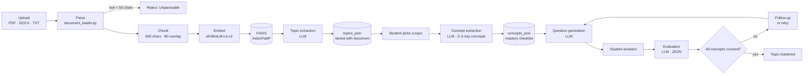

### Step-by-step

| # | Step | Detail |
|---|---|---|
| 1 | **Upload & parse** | `document_loader.load_document()` extracts plain text with `pypdf` / `python-docx`. Files yielding < 50 characters are rejected. The extracted text is stored with the study session so it can be re-indexed without a re-upload. |
| 2 | **Index (RAG)** | `RAGIndex` chunks text (600 chars, 80 overlap), embeds with `all-MiniLM-L6-v2` (normalized), stores in FAISS `IndexFlatIP` (cosine). Cached per document with `st.cache_resource`. |
| 3 | **Topic extraction** | `_sample_text()` samples ~4,800 chars evenly from start/middle/end. LLM returns 3–8 topic names (JSON array). Persisted and reused on later visits to avoid LLM topic-name drift. |
| 4 | **Concept extraction** | RAG retrieves chunks relevant to the chosen topic; LLM returns 3–5 key concepts. These become the mastery checklist. |
| 5 | **Question loop** | The agent picks the first uncovered concept, retrieves context, and generates one focused question (< 25 words, single aspect, no repeats). |
| 6 | **Evaluation** | LLM grades the answer against retrieved context only. Structured JSON: `score` (correct/partial/incorrect), `feedback`, optional `follow_up`, `missing`, `covered_concepts`. |
| 7 | **Mastery tracking** | Covered concepts are checked off. Weak answers trigger follow-ups (max 2 per question, then retry from a new angle). Topic is mastered only when every concept is covered. |
| 8 | **Persistence** | Every state change is written to `study_sessions` in Postgres/Supabase, so sessions resume after reload, browser restart, or on another device. |

---

## 3. Application State Machine (`app.py`)

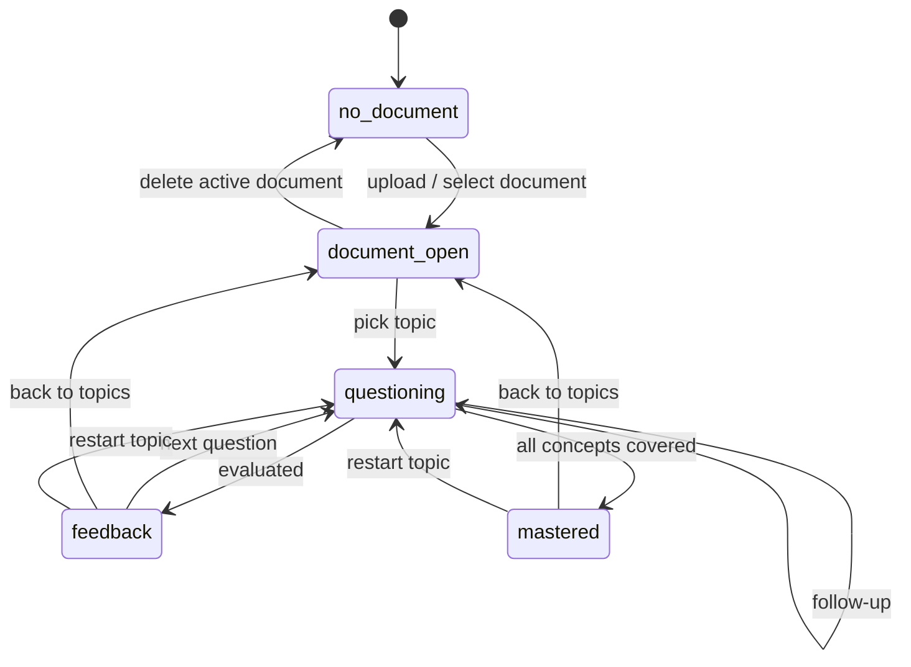

| State | Meaning | Transitions |
|---|---|---|
| `no_document` | No document selected. Sidebar lists the user's documents. | → `document_open` after upload or selecting a document |
| `document_open` | A document is active. Main view shows Topics / Review / Hidden. | → `questioning` when a topic is chosen |
| `questioning` | A question is active; chat input shown. | stays on follow-up → `feedback` / `mastered` after evaluation |
| `feedback` | Answer evaluated; action buttons shown. | → `questioning`, `document_open`, or restart |
| `mastered` | All key concepts covered 🎉 | → `document_open` or restart |

All runtime state (active document, agent instance, conversation, pending actions) lives in `st.session_state`. Durable state (documents, sessions, review lists, hidden topics, token usage) lives in Postgres.

### One document = one chat, one topic = one conversation

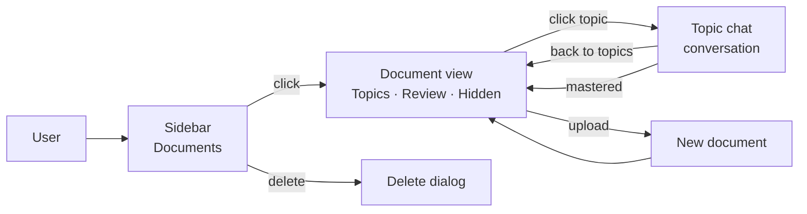

- The **sidebar** lists the user's uploaded documents (one entry per `document_name`, most recent first) and an "+ Upload" area.
- Clicking a document opens its **Topics / Review / Hidden** tabs in the main view, scoped strictly to that document.
- Clicking a topic opens its own **chat view** with a "← Topics" back button.
- Each (document, topic) pair maps to **exactly one session row**. Re-clicking a started topic resumes it instead of creating a duplicate.

### Review list

The **Review** tab shows every question scored `partial` or `incorrect` for the active document. Each entry records the topic, the student's answer, the evaluator's flagged missing concept, and the model that produced the evaluation. Scoped per (user, document) — mistakes from unrelated documents never mix.

### Confirmation dialogs

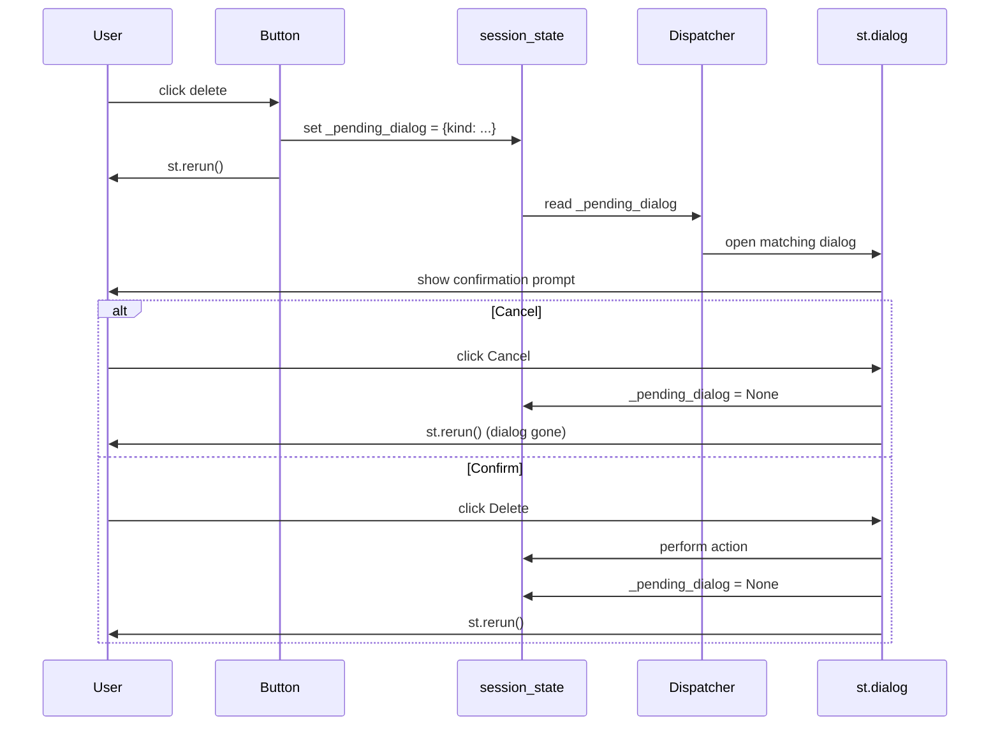

Dialogs guarded by `st.dialog` and opened via a single pending-action dispatcher (Streamlit only allows one dialog per rerun). Actions guarded: log out, delete document, hide topic, delete mistake, clear review list, restart topic.

---

## 4. Agent (`agent/study_agent.py`)

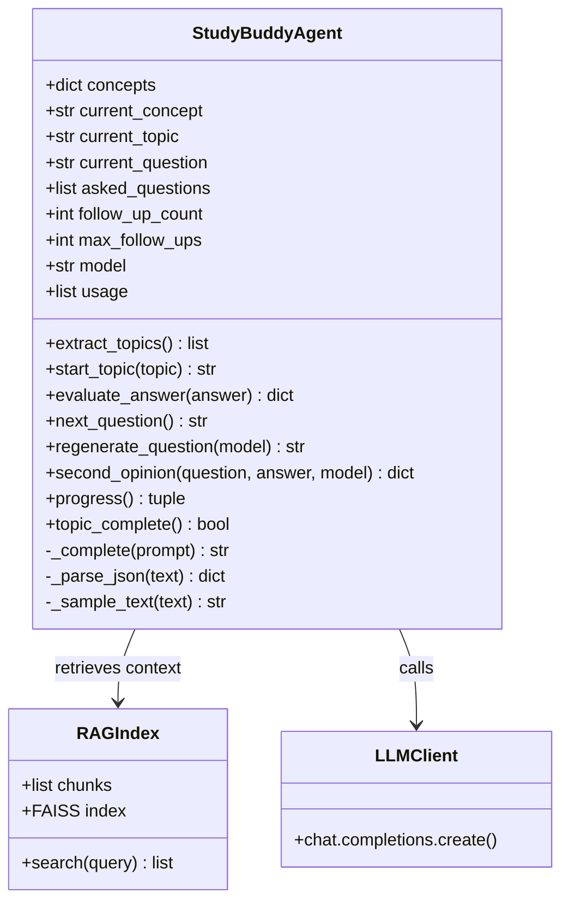

| Attribute | Purpose |
|---|---|
| `concepts: dict[str, bool]` | Mastery checklist — concept name → covered? |
| `current_concept` | Concept the active question targets |
| `asked_questions: list[str]` | History passed to the LLM to prevent repeated questions |
| `follow_up_count` / `max_follow_ups` | Limit follow-ups per question (2) before retrying from a new angle |
| `model` | Model identifier currently used for LLM calls |
| `usage: list[dict]` | Per-call token usage (`model`, `prompt_tokens`, `completion_tokens`) |

**Robust LLM output handling:** `_parse_json()` tolerates markdown code fences, `<think>…</think>` reasoning blocks, and JSON embedded in surrounding prose. If parsing fails entirely, the agent falls back to a neutral "partial" evaluation, so a malformed LLM response never crashes a session.

---

## 5. Multi-Model Support

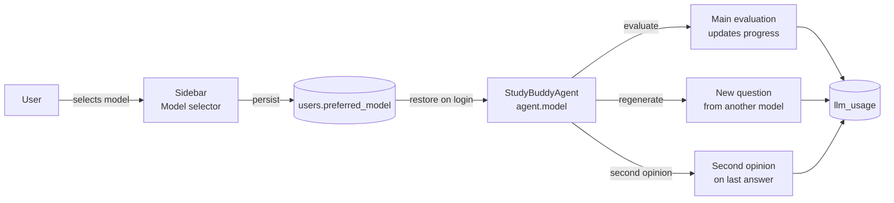

Users can pick their preferred model from the sidebar catalogue (`agent/models.py`). The choice is persisted per user in `users.preferred_model` and survives re-login.

Per-answer actions in the chat view:

- **New question from another model** — asks a different model for a fresh question on the current concept. Progress unchanged.
- **Second opinion on my last answer** — re-evaluates the last (question, answer) pair with another model. Progress unchanged.

### Token-usage tracking

Every LLM call is recorded in `llm_usage` (`model`, `prompt_tokens`, `completion_tokens`). The sidebar shows per-session totals and a warning if any single request exceeded `CONTEXT_WARN_SHARE` of the model's input limit. The largest single prompt — not the session total — is the figure of interest, because each call is sent without chat history.

---

## 6. Prompt Design (`agent/prompts.py`)

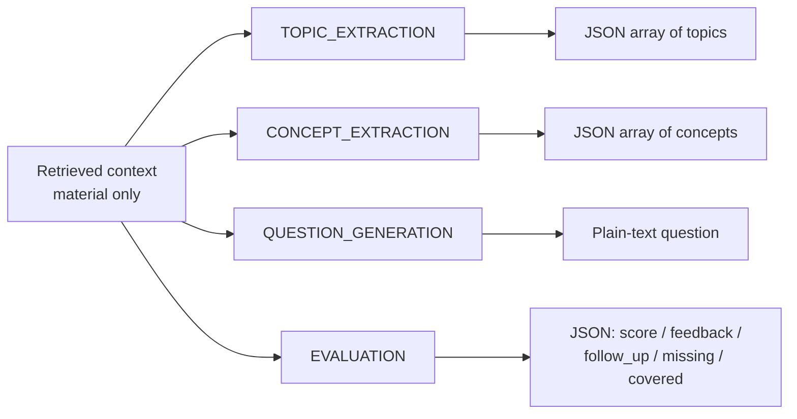

Two design rules shared by all prompts:

1. **Material-only grounding** — every prompt containing retrieved context carries a strict instruction to use *only* that context and never general knowledge.
2. **Language matching** — topics, concepts, questions, and feedback are generated in the language of the uploaded material (German slides → German questions).

### Evaluation JSON schema

```json
{
  "score": "correct | partial | incorrect",
  "feedback": "1-2 encouraging, specific sentences",
  "follow_up": "single-focus question addressing the biggest gap, or null",
  "missing": "the key concept the student missed, or null",
  "covered_concepts": ["names copied exactly from the checklist"]
}
```

---

## 7. Authentication & Session Persistence

### Signup / Login flow

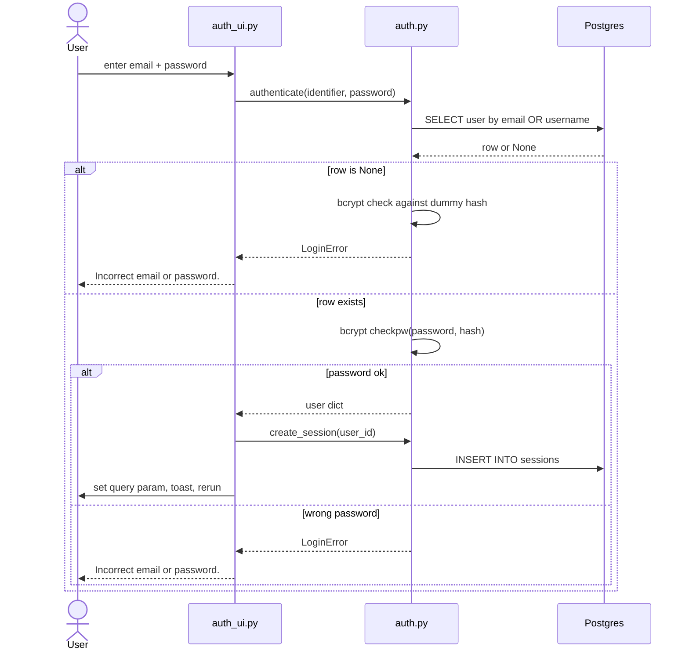

### Login persistence strategy

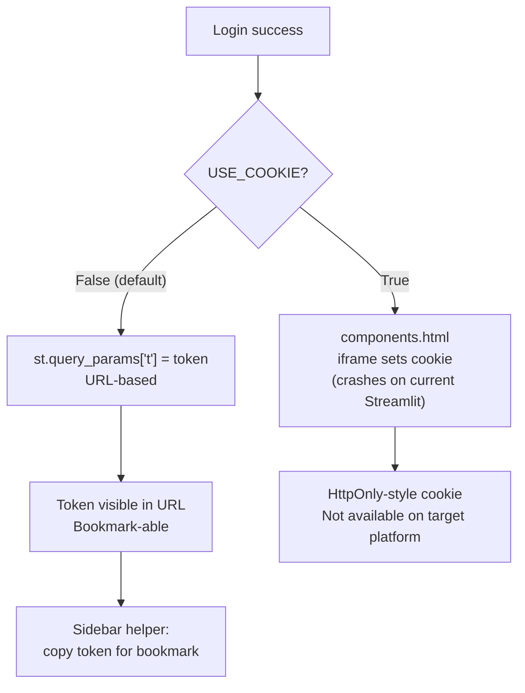

**Why URL, not cookie.** Streamlit can *read* cookies via `st.context.cookies`, but it cannot *set* them without iframe-based JavaScript (`components.html`, `st.iframe`, `declare_component`). On the deployed Streamlit line (≥ 1.58), any iframe content crashes the ASGI server:

```
RuntimeError: Expected ASGI message 'http.response.start',
but got 'http.response.body'.
```

Documented trade-off: token visible in URL/history, less secure than an HttpOnly cookie — but the only alternative on this platform is a login that does not survive a page reload.

**Escape hatch.** `auth_ui.py` provides a `USE_COOKIE` flag. Set to `True` on a Streamlit version without the ASGI crash (e.g. 1.49.x), it switches to `components.html`-based cookie writes automatically.

**Stay-signed-in helper.** The sidebar exposes a small expander containing the current token with a copy button, so the user can bookmark the login URL and open it in a new tab without logging in again.

### Sidebar UI

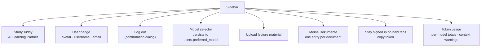

A minimum sidebar width and ellipsis truncation keep icons and buttons readable at any browser width.

---

## 8. Persistence Layer

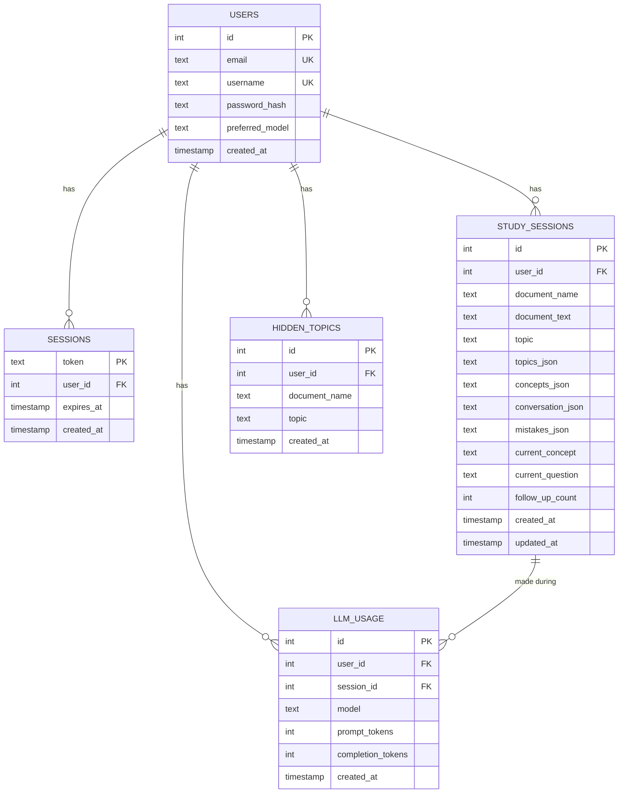

| Table | Purpose |
|---|---|
| `users` | Accounts (email, username, password hash, preferred model) |
| `sessions` | Persistent login tokens (token, user_id, expires_at) |
| `study_sessions` | Per (user, document, topic) state: document text, topics snapshot, concepts, conversation, mistakes, current question, follow-up count |
| `hidden_topics` | Topics the user has hidden per document, so they are filtered out on reload |
| `llm_usage` | Per-call token usage (model, prompt_tokens, completion_tokens, session_id) |

### Key helper functions

| Function | Role |
|---|---|
| `create_session` / `update_session` / `delete_session` | CRUD for study sessions |
| `list_sessions(user_id)` | All sessions for the sidebar/report |
| `list_documents(user_id)` | Distinct documents ordered by most recent activity |
| `load_document_meta(user_id, document_name)` | **One roundtrip** returning document text, topics snapshot, every session payload, and mistakes aggregated (deduped by `(topic, question)`) |
| `delete_document(user_id, document_name)` | Removes sessions and hidden-topics entries in one transaction |
| `hide_topic` / `unhide_topic` / `get_hidden_topics` / `get_hidden_topics_list` | Soft deletion of topics |
| `record_usage` / `usage_by_model` / `get_preferred_model` / `set_preferred_model` | Multi-model support |

### Topic persistence policy

The topic list is generated once per document and stored in the first session's `topics_json`. On later visits the stored snapshot is reused rather than re-generated, avoiding the LLM drift problem (a fresh extraction can yield slightly different topic names, which would break the hidden-topics filter and duplicate sessions).

---

## 9. Configuration

The app is configured entirely via `.env` / Streamlit secrets and works with any OpenAI-compatible API.

| Variable | Meaning | Example |
|---|---|---|
| `API_KEY` | API key for the LLM endpoint | — |
| `BASE_URL` | OpenAI-compatible base URL | `https://chat.kiconnect.nrw/api/v1` |
| `MODEL` | Default model identifier | `OpenAI-GPT-5-Mini` |
| `SUPABASE_DB_URL` | Postgres connection string (Supabase session pooler) | `postgresql://postgres.<ref>:<pw>@<host>.pooler.supabase.com:5432/postgres` |
| `SESSION_EXPIRY_DAYS` | Lifetime of a login session (default 30) | `30` |
| `CONTEXT_WARN_SHARE` | Warn when a single request uses more than this fraction of the model's input limit | `0.4` |

> Note: the currently used endpoint rejects non-default `temperature` values, so the agent deliberately sends none.

`agent/models.py` exposes `load_model_options()` returning `{model_name: context_limit}` for every model available on the endpoint. The sidebar selector uses this dictionary, and the same dict powers the "another model" actions and the context-limit warnings in the usage panel.

---

## 10. Performance

Early versions rebuilt the sentence-transformer index on every topic click and ran one DB query per session per document render, which made the UI feel unresponsive on Supabase's network latency. The following measures bring the interactive path down to sub-second UI latency.

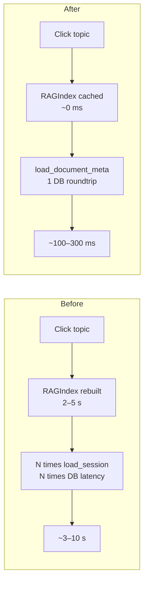

| Measure | Effect |
|---|---|
| `RAGIndex` cached via `st.cache_resource`, mirrored into `session_state._rag_cache` | Sentence-transformer model loaded once per document; pre-warmed during upload so first topic click is instant |
| `history.load_document_meta()` — single roundtrip with all session payloads | Replaces N+1 `load_session()` calls in `_open_document`, `_render_topics_tab`, `_find_session_in_meta` |
| `_docs_cache` in `session_state` | Sidebar document list fetched once; invalidated on upload, delete, topic start |
| `_doc_meta_cache` in `session_state` | Per-document metadata cached; invalidated after every mutation |
| Explicit invalidators (`_invalidate_docs_cache`, `_invalidate_doc_meta`, `_invalidate_rag`) | UI never shows stale state after a write |

LLM calls remain network-bound and dominate the perceived latency for a *new* question. Everything else — sidebar renders, document switching, tab switches, dialog opens — is fast.

---

## 11. Testing & CI

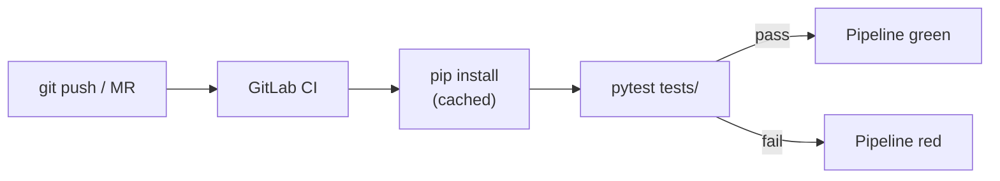

Deterministic logic is covered by `pytest`:

- **JSON parsing** — plain JSON, markdown fences, `<think>` blocks, JSON embedded in prose, invalid input
- **Text sampling** — short documents returned whole; long documents sampled from start/middle/end within budget
- **Concept matching** — exact, case-/whitespace-insensitive, unknown names ignored
- **Chunking** — size limits, overlap correctness, blank-line collapsing, empty input
- **Document loading** — TXT decoding, rejection of unsupported file types
- **Answer-evaluation state machine** (`tests/test_evaluation_state_machine.py`) — mocks `agent._complete()` and covers correct/partial/incorrect/off-topic, follow-up limits, topic completion, malformed-response fallback

```bash
python -m pytest tests/ -v
```

The evaluation-state-machine tests use an `autouse` fixture that sets dummy environment variables via `monkeypatch`, since `StudyBuddyAgent.__init__` immediately creates an OpenAI client.

`.gitlab-ci.yml` runs `pytest tests/` on every push and merge request, with pip-caching enabled. The repository is mirrored to GitHub because Streamlit Community Cloud deploys from GitHub, not GitLab.

LLM-dependent behavior (question quality, evaluation accuracy) is validated manually through exploratory testing with real lecture materials.

---

## 12. Deployment

The app is deployed on **Streamlit Community Cloud** using a GitHub mirror of the GitLab repository (Community Cloud supports GitHub only). Secrets are stored in the Streamlit secrets manager as TOML (`KEY = "value"`).

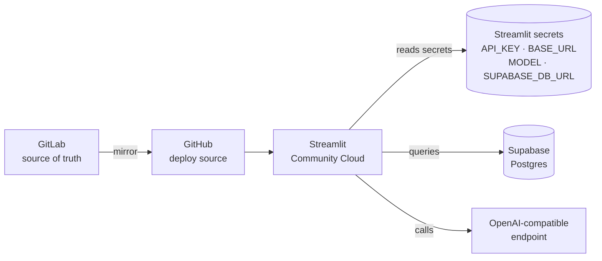

Common failure modes and mitigations:

- **Streamlit version.** `requirements.txt` pins `streamlit==1.49.1`, the last stable version before the Starlette-based server that crashes on static asset serving.
- **Supabase connection.** Host must be the **session pooler** host, not the direct-connection host (direct uses IPv6 by default and breaks on some platforms). Copy `aws-0-…` vs `aws-1-…` prefix exactly from the dashboard.
- **Secrets format.** TOML requires double quotes around values; placeholder remnants like `YOUR_PASSWORD` cause `FATAL: tenant/user not found`.

### Docker deployment

Two build-time decisions keep the image practical:

- **CPU-only PyTorch** — the default Linux `torch` wheel bundles CUDA libraries and inflates the image by gigabytes; the Dockerfile installs the CPU build instead.
- **Embedding model baked into the image** — `all-MiniLM-L6-v2` is downloaded at build time, so a fresh container answers the first upload immediately.

Credentials are never part of the image: `.env` is excluded via `.dockerignore` and injected at runtime (`env_file` in Compose or `docker run --env-file .env`).

---

## 13. Known Limitations & Platform Notes

### Streamlit ASGI static-files crash

On the deployed Streamlit version line (≥ 1.58), iframe content crashes the ASGI server with:

```
RuntimeError: Expected ASGI message 'http.response.start',
but got 'http.response.body'.
```

Affects:

- Favicon and other static assets (benign log noise, no user-visible effect)
- `components.html` and `st.iframe`, required for **cookie-based login persistence** and **auto-scroll to the latest chat message**

Mitigations:

- **Login persistence** — URL token via `st.query_params`. `USE_COOKIE` flag switches to the iframe path on a version without the bug.
- **Auto-scroll** — feature removed rather than shipping crashing code. The chat still works; the user scrolls manually.
- **Version pin** — `requirements.txt` pins `streamlit==1.49.1`, the last stable version before the Starlette-based server.

### Other limitations

- **No spaced repetition** — mastery is tracked per topic per document, not scheduled over time.
- **No multi-document support** — topics are per document; cross-document mastery is not tracked.
- **No end-of-session export** — the review list is visible in the app but not exportable.
- **No OCR** — scanned PDFs without a text layer are rejected as unparseable.
- **Single document context** — each study session is scoped to one document; the RAG index does not span multiple documents.

---

## 14. Design Decisions

- **No agent framework (LangChain etc.)** — the pipeline is a small, fixed sequence of LLM calls plus one vector index. Direct use of the OpenAI client and FAISS keeps the code transparent, debuggable, and dependency-light.
- **Material as ground truth** — grounding everything in the uploaded document is what makes the tool useful for exam preparation (it tests *the course*, not the internet).
- **Concept checklist as mastery criterion** — an explicit, inspectable definition of "topic fully explained", visible as a progress bar and checklist, rather than an opaque LLM judgment.
- **Follow-up limit with retry-from-new-angle** — prevents frustrating dead-end loops on a single question while still refusing to skip unmastered concepts.
- **One session per (document, topic)** — clicking a started topic resumes it instead of duplicating it, so the sidebar stays a stable list of conversations.
- **URL-token login over cookie login** — the only mechanism that reliably persists a session on the target platform. Documented trade-off: token visible in URL, no HttpOnly protection.
- **Pending-action dispatcher for dialogs** — Streamlit only allows one dialog per rerun, so destructive buttons set a pending flag and a single dispatcher opens the matching dialog.
- **Model choice is a user preference, not a server-side default** — students can pick what they trust; the choice is persisted and applied to every subsequent LLM call, including "second opinion" and "new question" actions.

---

## 15. Contributions

This section records who developed which parts of the project. The code contributions can be verified against the commit history with `git log`.

### Ibrahim Zarouri

| Area | Files |
|------|-------|
| Document processing (PDF, DOCX, TXT) | `tools/document_loader.py` |
| RAG pipeline: chunking, embeddings, FAISS index | `tools/rag.py` |
| Agent: topic and concept extraction, question generation, answer evaluation, mastery tracking, retry on rate limits | `agent/study_agent.py` |
| Prompt design | `agent/prompts.py` |
| Streamlit UI and application state machine | `app.py` |
| Unit test suite (parsing, sampling, chunking, document loading) | `tests/test_study_agent.py`, `tests/test_tools.py`, `conftest.py` |
| Docker setup | `Dockerfile`, `docker-compose.yml`, `.dockerignore` |
| Streamlit Cloud deployment | `.streamlit/config.toml`, `requirements.txt` |
| Project website | `docs/index.html` |
| Dev container | `.devcontainer/devcontainer.json` |
| Documentation | `README.md`, `DOCUMENTATION.md` |
Contributed via commits to this repository, verifiable against `git log`.

### Ahmad Morad + Ibrahim Shaban

| Area | Files |
|------|-------|
| Review list that collects partially or incorrectly answered questions and shows them in the sidebar | `app.py` (`_render_mistakes` and the mistake recording in the evaluation flow) |
| Multi-user authentication: signup, login, bcrypt password hashing, constant-time authentication against a dummy hash (timing-attack mitigation), input validation | `auth.py`, `auth_ui.py` |
| Persistent login sessions: URL-token based (survives new tabs and browser restarts), optional cookie path behind a `USE_COOKIE` flag; expired-session cleanup on login | `auth.py`, `auth_ui.py` |
| Database schema for users, login sessions, study sessions, hidden topics and LLM usage (Postgres / Supabase) | `schema.sql` |
| Per-user study-session persistence (resume, delete past sessions across topics/documents), scoped mistakes per (user, document), single-roundtrip document metadata loader | `history.py`, `schema.sql` |
| DeepSeek-style chat UI: sidebar lists uploaded documents, per-document Topics / Review / Hidden tabs, per-topic chat view with back navigation, one session per (document, topic) | `app.py` |
| Confirmation dialogs (`st.dialog` decorator + single pending-action dispatcher) for logout, delete document, hide topic, delete mistake, clear review list, restart topic | `app.py` |
| Performance: `RAGIndex` cached via `st.cache_resource` and pre-warmed on upload; document list and document metadata cached in `session_state`; `load_document_meta()` replaces N+1 `load_session()` calls | `app.py`, `history.py` |
| Model selector and preferred-model persistence per user; per-call token-usage tracking with per-model totals and context-limit warnings; "second opinion" and "new question from another model" actions | `agent/models.py`, `history.py`, `agent/study_agent.py`, `app.py`, `schema.sql` |
| Sidebar restyle: minimum width, ellipsis truncation, flexible button rows, avatar badge, stay-signed-in helper with copy button | `app.py`, `auth_ui.py` |
| Streamlit version pin and documented query-param workaround for cookie-based login | `requirements.txt` |
| Unit tests for the answer-evaluation state machine (mocked LLM responses covering correct, partial, incorrect/off-topic, follow-up limits, malformed-response fallback) | `tests/test_evaluation_state_machine.py` |
| GitLab CI pipeline running the test suite on every push and merge request | `.gitlab-ci.yml` |
| Environment configuration for authentication and the Supabase connection | `.env.example`, `requirements.txt` |

Contributed via commits to this repository, verifiable against `git log`.

---

## 16. Future Work

- **Spaced repetition** — schedule review sessions based on past mistakes and elapsed time.
- **Multi-document support** — a whole-course index with cross-document mastery tracking.
- **End-of-session summary and export** — a short recap ("mastered X, review Y") and PDF/Markdown export.
- **Optional OCR** for scanned PDFs.
- **Reintroduce auto-scroll and cookie-based login** once the target Streamlit version no longer crashes on iframe content, or on a self-hosted deployment behind a reverse proxy that can set cookies server-side.
- **Richer context management** — pass conversation history to the LLM selectively (currently every call is stateless, so long inputs reduce reliability; the usage panel surfaces this).

---

*Last updated: 2026-10-20. This document supersedes the previous version and reflects the current code on `main` (authentication, Supabase persistence, DeepSeek-style chat UI, multi-model support, confirmation dialogs, performance caching, Streamlit version pin).*